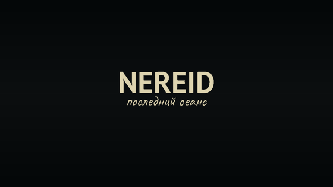
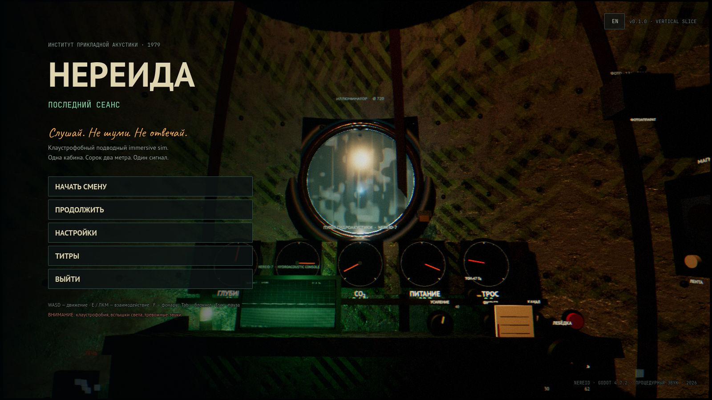
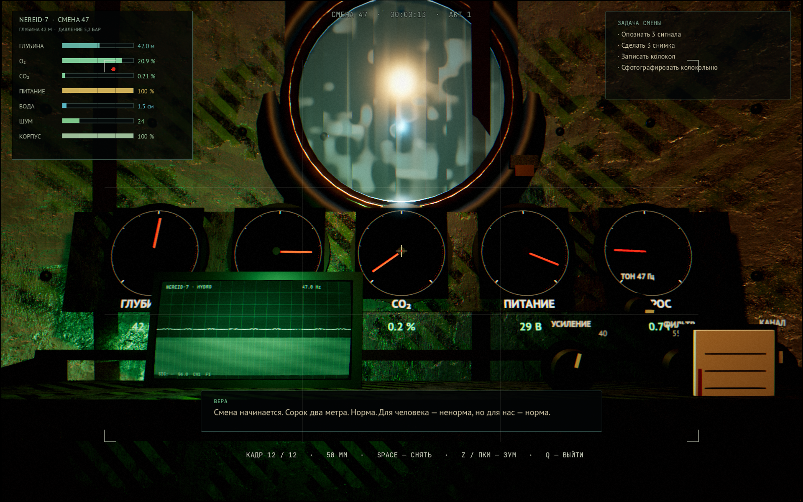
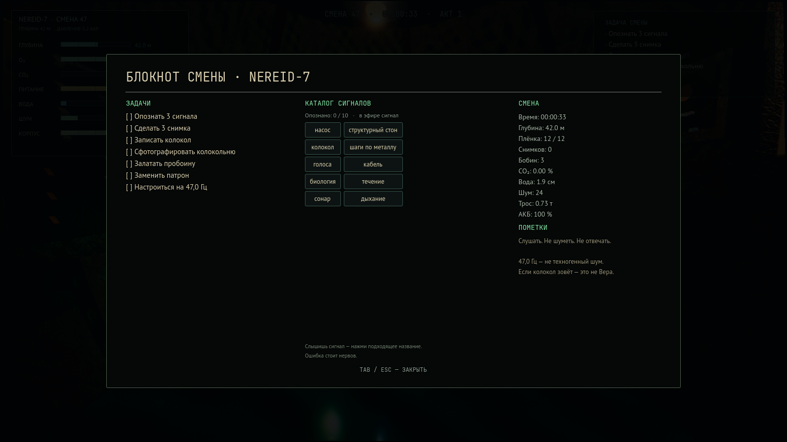
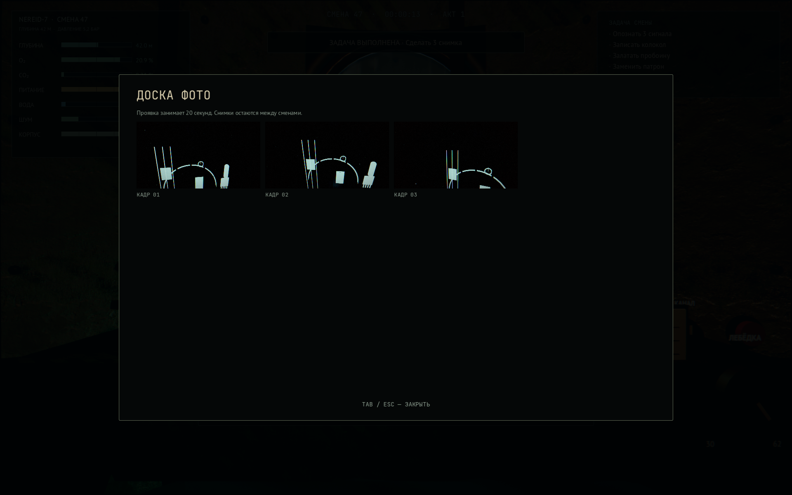
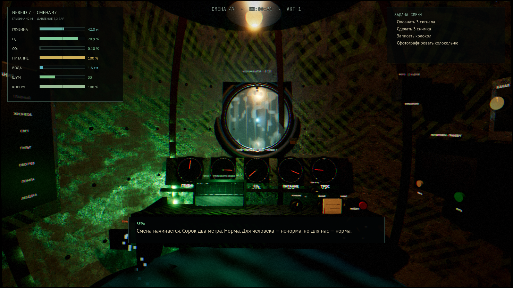
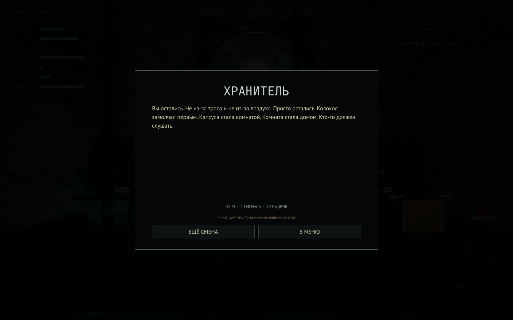
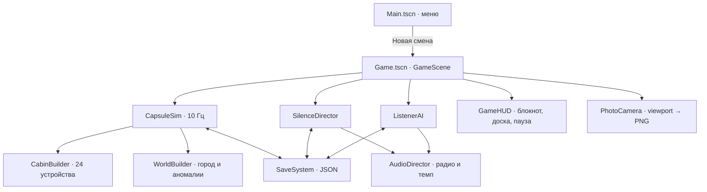

# NEREID · «Нереида: последний сеанс»

> **Клаустрофобный подводный immersive sim в одноместной капсуле.**
> Слушай. Не шуми. Не отвечай.

[](https://godotengine.org)
[](https://docs.godotengine.org)
[]()
[]()
[](LICENSE)
[]()

[**Скачать билд**](https://github.com/geekAmis/NEREID/releases/latest) · [**Трейлер (MP4)**](docs/media/nereid-trailer.mp4) · [**Issues**](https://github.com/geekAmis/NEREID/issues) · [**План разработки**](.docs/PLAN.md) · [**AI в игре**](.docs/AI_IN_GAME.md)

[](docs/media/nereid-trailer.mp4)

*19 секунд из смены. Полный трейлер — в MP4; GIF — облегчённый превью.*

---

## Что это

1979 год. Затопленный город Китежск. Вы — акустик в капсуле «Нереида-7», подвешенной на тросе в 42 метрах над крышей Института прикладной акустики. За одну смену нужно доказать, что объект акустически мёртв.

Проблема в том, что объект отвечает.

**NEREID** — игра про слух, рутину и тишину. Одна кабина. Двадцать четыре устройства. Двенадцать кадров плёнки. Четыре финала. Никакого открытого мира и никаких монстров в кадре — только вода, приборы и то, что вы предпочтёте не слышать.

### In English

> *NEREID is a claustrophobic underwater horror immersive sim set in a one-person hydroacoustic capsule, 42 metres above a drowned town. Listen through the hydrophone, identify ten signals, photograph what should not be there, keep the cabin alive — and never answer the bell. Godot 4.7.2, Forward+, procedural cabin, fully synthesized audio, 101 headless checks.*

---

## Скриншоты

| Меню | Кабина |
|---|---|
|  |  |

| Блокнот смены | Доска фото |
|---|---|
|  |  |

| Пульт и иллюминатор | Финал |
|---|---|
|  |  |

---

## Что внутри

- **Одна живая кабина.** Кислород, CO₂, электричество, вода в трюме, натяжение троса, температура, шум и пульс связаны в одну детерминированную симуляцию с шагом 10 Гц.
- **Слух вместо зрения.** Гидрофон с усилением, фильтром и диаграммой направленности; активный пинг; CRT-спектр; каталог из десяти сигналов; запись на бобины.
- **Шум — валюта.** Каждое действие слышно внизу. Тишина — тактическое решение, а не пауза.
- **Фотография как улика.** Двенадцать кадров, вспышка, зум, проявка 20 секунд. На плёнке видно то, чего нет в иллюминаторе.
- **Диегетический интерфейс.** Никаких летающих маркеров: стрелочные шкалы, тумблеры, CRT, бумажный блокнот, пробковая доска.
- **Режиссёр тишины.** Utility-контроллер управляет темпом, а «Слушатель» — FSM на графе внимания, которая реагирует на шум, свет, пинг и лебёдку.
- **Четыре финала.** «Всплытие», «Ответ», «Хранитель» и «Трос оборван» — плюс пять смертей от систем кабины.
- **Ручная озвучка.** 28 реплик Веры и 4 ленты Гринберга, сгенерированные через Windows SAPI (Microsoft Irina, ru-RU) и пропущенные через радио-шину.
- **Графика, которую не стыдно показать.** Six CC0 PBR-наборов, объёмный туман, конденсат, зерно, хроматическая аберрация, ACES, SSAO, свечение и фоторежим.

---

## Скачать и запустить

### Готовый билд

1. Откройте [Releases](https://github.com/geekAmis/NEREID/releases/latest).
2. Скачайте `NEREID-0.1.0-win64.zip`.
3. Распакуйте в любую папку и запустите `NEREID.exe`.

Билд не требует установки, интернета и внешних ассетов: PCK встроен в exe.

### Из исходников

Нужен **Godot 4.7.2** (Forward+).

```bash
git clone https://github.com/geekAmis/NEREID.git
cd NEREID
godot --path game --import
godot --path game
```

Или откройте `game/project.godot` в редакторе и нажмите **F5**.

### Сборка Windows-билда

```bash
# шаблоны экспорта должны быть установлены для 4.7.2
godot --headless --path game --export-release "Windows Desktop" build/NEREID.exe
```

---

## Управление

| Действие | Клавиша |
|---|---|
| Движение | `WASD` |
| Осмотр | Мышь |
| Взаимодействие | `E` / `ЛКМ` |
| Альтернативное действие | `ПКМ` |
| Вращение рукоятки | `ЛКМ` + движение мыши |
| Крутить вентиль / шкалу | Колесо / `ЛКМ` + мышь |
| Фонарь | `F` |
| Блокнот | `Tab` |
| Скрыть HUD | `H` |
| Пауза | `Esc` |
| Субтитры | `C` |
| Фото (в режиме камеры) | `ЛКМ` / `Space` |
| Зум | `ПКМ` / `Z` |
| Выход из режима камеры | `Q` |

Все действия переназначаются в **Настройки → Управление**.

---

## Игровой цикл

```text
СЛУШАТЬ  →  ОПОЗНАТЬ  →  ЗАПИСАТЬ  →  СФОТОГРАФИРОВАТЬ  →  ВЫЖИТЬ
   ↑                                                              │
   └──────────────────── тишина / ресурсы / Слушатель ───────────┘
```

1. **Слушать.** Гидрофон ловит сигналы: насос, стон корпуса, колокол, шаги, голоса, кабель, биологию, течение, сонар, дыхание.
2. **Опознать.** В блокноте десять кнопок. Правильное совпадение фиксирует сигнал; ошибка стоит нервов.
3. **Записать.** Три бобины, ограниченный ресурс. Запись — тоже шум.
4. **Сфотографировать.** Двенадцать кадров. Аномалии видны только на вспышке и только на плёнке.
5. **Выжить.** CO₂, вода, ток, трос и Слушатель не ждут. Каждое действие имеет цену в децибелах.

### Системы кабины

| Система | Что делает | Как ломается |
|---|---|---|
| Дыхание | O₂-вентиль, скруббер, два запасных патрона | CO₂ > 5,2 % → асфиксия; O₂ < 11 % → гипоксия |
| Энергия | Кабель с поверхности до 300 с, затем АКБ и ручной генератор | Разряд + высокий CO₂ → «Темнота» |
| Вода | Приток 18 л/мин, помпа, латка | 24 см → затопление |
| Корпус | Прочность, удары Слушателя, латка | 0 % → имплозия |
| Трос | Натяжение, лебёдка, балласт, резак | Перегруз > 8 с → обрыв; без балласта → «Трос оборван» |
| Климат | Температура, влажность, скорость рук | Холод замедляет взаимодействие |
| Шум | Постоянный + импульсный, история 30 с | Привлекает Слушателя, повышает стресс |

### Финал

Финальная доступность открывается на **860-й секунде**. Дальше:

- **Всплытие** — сбросить балласт, затем перерезать трос.
- **Ответ** — передать в эфир, когда колокол звонит.
- **Хранитель** — передать, когда колокол молчит.
- **Трос оборван** — перерезать трос без балласта.

---

## Технологии

- **Godot 4.7.2**, Forward+, typed GDScript.
- Процедурная геометрия кабины и мира — без внешних сцен.
- **CapsuleSim** — `RefCounted`, фиксированный шаг 0.1 с, детерминированный seed.
- **SilenceDirector** — utility-подход к темпу: ресурсное давление, прогресс акта, вес Слушателя, нарушения тишины.
- **ListenerAI** — FSM `dormant → curious → approach → circle → strike → retreat` на графе из 9 внешних узлов.
- **AudioSynth** — 31 процедурный поток (гул, помпа, вода, капли, скрип, колокол, пинг, хор, статика, шаги), без внешних сэмплов.
- **7 аудиошин**: Master, SFX, UI, Hydrophone, Radio, Voice, Underwater — с фильтрами, компрессорами и реверберацией.
- **Постобработка** одним full-screen pass: зерно, виньетка, хроматическая аберрация, бочка, тревога, вспышка.
- **Сохрания** — JSON в `user://`, один слот, автосейв каждые 20 с, версия схемы.
- **Тесты** — 101 headless-проверка: симуляция, отказы, финалы, директор, Слушатель, сериализация, сейв, 20-минутный прогон с автопилотом.

### Архитектура



---

## Разработка

### Требования

- Windows 10/11 x64 или Linux x64.
- **Godot 4.7.2** (Forward+).
- Python 3.10+ — только для генерации озвучки и сборки трейлера.
- GPU: GTX 1060 6 GB / RX 580 8 GB или лучше.

### Структура репозитория

```text
.
├─ game/                    # Godot-проект
│  ├─ assets/               # PBR-текстуры, шрифты, 32 WAV-реплики
│  ├─ data/                 # signals, radio, tapes, anomalies
│  ├─ scenes/               # Main.tscn, game/Game.tscn
│  ├─ scripts/
│  │  ├─ core/              # sim, director, listener, save, game, locale
│  │  ├─ cabin/             # cabin builder, devices, gauges, interactable
│  │  ├─ world/             # sunken town, cables, particles, anomalies
│  │  ├─ audio/             # synth, audio director
│  │  ├─ ui/                # HUD, CRT, settings
│  │  ├─ player/            # first-person controller
│  │  ├─ fx/                # post-process, photo camera
│  │  └─ game/              # GameScene orchestration
│  ├─ shaders/              # post, crt, glass, water
│  └─ tests/                # run_tests, capture, trailer
├─ tools/                   # voice generation, bus layout, trailer assembly
├─ docs/media/              # скриншоты и трейлер для README
├─ .docs/                   # PLAN, AI_IN_GAME, PLANNING_ROOM, 7 рецензий, issues
├─ .docs/ci/tests.yml       # готовый GitHub Actions workflow
└─ README.md
```

### Headless-тесты

```bash
godot --headless --path game --import
godot --headless --path game --script res://tests/run_tests.gd
```

Ожидаемый вывод:

```text
PASS: 101 checks
```

Тесты покрывают:

- стартовые инварианты и фиксированный шаг;
- приток/помпу/латку, CO₂/скраббер, все пять смертей;
- балласт, трос, лебёдку и финалы;
- опознание сигналов и фотографии;
- переходы актов директора и финальную доступность;
- FSM Слушателя, удар и обрыв троса от перегруза;
- сериализацию всех трёх систем и round-trip сейва;
- 20-минутный прогон с автопилотом (без смерти, финал доступен).

### Генерация озвучки

```powershell
powershell -ExecutionPolicy Bypass -File tools/generate_voice.ps1 -Force
godot --headless --path game --import
```

Скрипт читает `radio.json` и `tapes.json`, озвучивает 32 реплики голосом **Microsoft Irina Desktop (ru-RU)** в `game/assets/voice/` и не перезаписывает файлы без `-Force`.

### Скриншоты и трейлер

```bash
# один кадр: сцена, путь, кадры ожидания, [позиция камеры], [поворот], [fov], [действие]
godot --path game res://tests/capture.tscn -- res://scenes/game/Game.tscn shot.png 760 "-" "-" "70" "camera"

# полный трейлер: 189 PNG-кадров в _frames/
godot --path game res://tests/trailer.tscn
python tools/make_trailer.py
```

`tools/make_trailer.py` собирает `docs/media/nereid-trailer.gif`, `.webp` и `.mp4` (нужен `imageio-ffmpeg`).

### Аудиошины

`game/default_bus_layout.tres` генерируется скриптом:

```bash
godot --headless --path game --script res://tools/build_buses.gd
```

---

## План разработки

<details>
<summary><b>M0–M10: от нуля до релиза</b> (нажмите, чтобы развернуть)</summary>

### M0. Пре-продакшн — готово
- [x] План, AI-концепция, планировка кабины.
- [x] Семь рецензий специалистов (критик, программист, SEO, главный сценарист, ассистент, физик, владелец инди-студии).
- [x] TODO и issue-трекер.
- [x] Референс-борд: 6 CC0 PBR-наборов, палитра, шрифты.
- [ ] Проверка товарного знака «Nereid» (юридическая, не блокирует код).

### M1. Кабина — готово
- [x] Процедурная сфера с вырезом под иллюминатор.
- [x] PBR-материалы, трипланарная проекция.
- [x] Свет: тёплый, CRT, аварийный, холодный, фонарь.
- [x] Игрок, движение, взаимодействие, дыхание.
- [x] Рёбра, болты, трубы, этикетки, коллизии.

### M2. Симуляция — готово
- [x] `CapsuleSim`: O₂, CO₂, ток, вода, корпус, глубина, трос, температура, шум, стресс.
- [x] Шкалы и цифровые индикаторы.
- [x] Отказы и финалы.
- [x] Балансировка на 20-минутную сессию.
- [x] Headless-тесты инвариантов.

### M3. Устройства — готово
- [x] 24 интерактивных устройства с анимацией и звуком.
- [x] Щиток питания, скраббер, лебёдка, помпа, латка.
- [x] Рация, магнитофон, блокнот, доска фото, фотоаппарат.
- [x] Секретный тумблер «47 Гц».

### M4. Слух — готово
- [x] 31 процедурный аудиопоток.
- [x] Гидрофон: gain, filter, channel, ping.
- [x] CRT: осциллограф + водопад (DFT), 10 сигналов.
- [x] Каталог и журнал в блокноте.

### M5. Фотография — готово
- [x] Режим камеры, вспышка, зум, 12 кадров.
- [x] Захват viewport в PNG без HUD.
- [x] Слой аномалий, видимый только на вспышке.
- [x] Проявка 20 с и доска фото.

### M6. AI и режиссура — готово
- [x] SilenceDirector: tension, cooldown, акты.
- [x] Listener: FSM, граф внимания, удар без мгновенной смерти.
- [x] Процедурные реплики Веры (28).
- [ ] k-NN-классификатор сигналов (v0.2).
- [ ] Опциональный локальный LLM-радио (Ollama) (v0.3).

### M7. Нарратив — готово на 80 %
- [x] Три акта, 6+1 задач.
- [x] 32 озвученные реплики (Вера + Гринберг).
- [x] Финалы «Всплытие», «Ответ», «Хранитель», «Трос оборван».
- [ ] Отдельные сцены для двух финалов (v0.2).
- [ ] Профессиональная актриса на Веру (v0.3).

### M8. UI/UX — готово
- [x] Меню на фоне живой кабины.
- [x] HUD: торец, подсказки, субтитры, тосты.
- [x] Пауза, настройки, качество, язык RU/EN.
- [x] Субтитры и предупреждение о клаустрофобии.

### M9. Полировка — готово
- [x] Постобработка: зерно, виньетка, аберрация, бочка.
- [x] Шейдеры стекла, воды, CRT, фото.
- [x] 7 аудиошин и радио-фильтр.
- [x] Профили качества.
- [x] Трейлер, скриншоты, README.

### M10. Релиз — готово для GitHub
- [x] Windows-билд с встроенным PCK.
- [x] CI-рецепт headless-тестов (`.docs/ci/tests.yml`, включается с `workflow` scope).
- [x] Тег `v0.1.0-vertical-slice`.
- [x] GitHub Release с билдом и трейлером.
- [ ] Steam-страница и Next Fest (v0.4).
- [ ] Полная английская локализация (v0.2).

</details>

---

## Известные ограничения

- Вертикальный срез: 20–30 минут на смену, один слот сохранения.
- Английская локализация меню и части реплик неполная.
- Внешний мир (затопленный город) намеренно тёмный и низкополигональный; это не открытая локация.
- Геймпад и Steam Deck не поддерживаются.
- Голос Веры — SAPI, не живая актриса.
- Отдельные кинематографические сцены для финалов «Тишина» и «Хранитель» — в v0.2 (issue #3).
- Дым/партиклы и некоторые аномалии могут мерцать на слабых GPU при качестве «Высокое».

---

## Документация

- [`.docs/PLAN.md`](.docs/PLAN.md) — полный производственный план.
- [`.docs/AI_IN_GAME.md`](.docs/AI_IN_GAME.md) — архитектура Director/Listener/LLM.
- [`.docs/PLANNING_ROOM.md`](.docs/PLANNING_ROOM.md) — планировка кабины и маршруты.
- [`.docs/ISSUES.md`](.docs/ISSUES.md) — локальный issue-трекер.
- [`.docs/TODO.JSON`](.docs/TODO.JSON) — пошаговый план в JSON.
- [`.docs/`](.docs/) — семь рецензий специалистов.
- [`CHANGELOG.md`](CHANGELOG.md) — история версий.
- [`THIRD_PARTY.md`](THIRD_PARTY.md) — лицензии ассетов.

---

## Лицензия и кредиты

Код — **MIT** (см. [`LICENSE`](LICENSE)). Текстуры — **CC0** (ambientCG), шрифты — **OFL** (PT Sans, JetBrains Mono, Caveat). Полный список — в [`THIRD_PARTY.md`](THIRD_PARTY.md).

Сделано на **Godot 4.7.2**. Вдохновлено *Iron Lung*, *Split*, *Horror Vacui* и *ROUTINE*.

> **Слушай. Не шуми. Не отвечай.**
